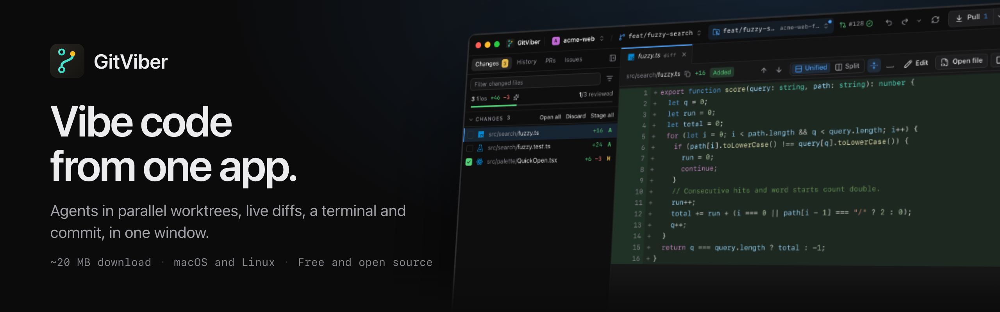
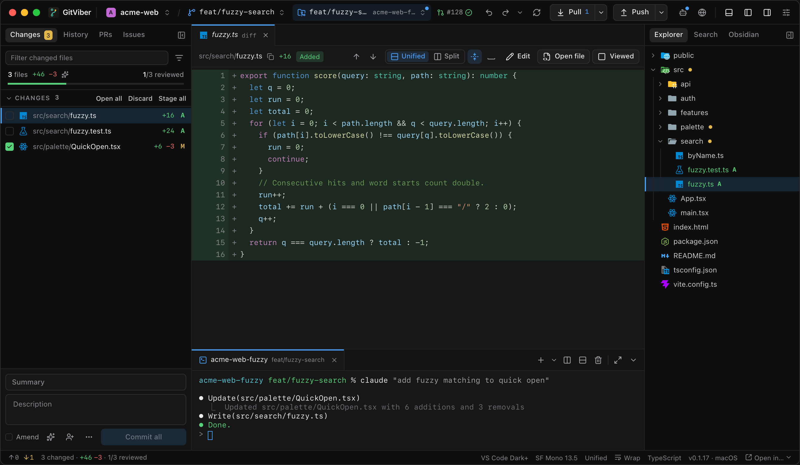

<p align="center">
  
</p>

<p align="center">
  <a href="https://github.com/emircan-sahin/gitviber/releases/latest"></a>
  <a href="https://github.com/emircan-sahin/gitviber/actions/workflows/ci.yml"></a>
  
  <a href="LICENSE"></a>
</p>

<p align="center">
  <a href="https://github.com/emircan-sahin/gitviber/releases/latest"><b>Download</b></a>
  ·
  <a href="#install">Install</a>
  ·
  <a href="https://emircan-sahin.github.io/gitviber/">Website</a>
  ·
  <a href="docs/FEATURES.md">Every feature</a>
  ·
  <a href="CHANGELOG.md">What's new</a>
</p>

## Why GitViber

Coding with agents turned the day into reading code. You run Claude Code or Codex in a few
worktrees, and juggle an editor to read files, a git client for diffs, terminals to run things and
a browser to check the result. GitViber is all of it in one window, and your agents can use the
window too.

|  |  |
| --- | --- |
| **Agents get a browser** | On macOS, Claude Code and Codex open pages, click, type and read the console in tabs of their own, in the background. |
| **~20 MB download** | Native Rust drawn on the GPU, with no web view under the window. About 100 MB of memory with a repo open, and a closed tab or terminal gives its memory back. [Measured](docs/FEATURES.md#size-memory-and-speed). |
| **Waits for changes** | File changes come from the system's file events, not from scanning the disk. |
| **Plain git, no telemetry** | Your own git, config, hooks and signing. No account, no API keys. [Details](docs/PRIVACY.md). |

<p align="center">
  
</p>

---

## Your agents, side by side

**Every agent gets its own worktree, and you see all of them at once.**

- **Switch from the top bar.** Each worktree shows its change count, pull request and check status.
- **Start from anything.** A branch, a commit, an issue or a pull request. A new worktree can run
  `claude` right away and gets your `.env` copied in.
- **Know who needs you.** A ring while Claude Code works, a dot when it finishes or asks, a desktop
  notification if you want one. The Agents menu lists every agent, the waiting ones first.
- **Pick up where you left off.** Quit with agents running and the restored terminal has the
  command that resumes the conversation already typed.

[More: worktrees and agents →](docs/FEATURES.md#worktrees-and-agents)

## A browser your agents can use

**Agents in your terminal can drive a real browser, right inside GitViber** (macOS for now).
Turn it on in Settings → Browser: Claude Code and Codex learn the `gitviber browser` command by themselves, and any other agent gets a note to paste.

- **Hidden, and out of your way.** Agents work in tabs of their own, opened in the background. They
  never take your window, your pointer, your keyboard or your clipboard.
- **Keeps working when you don't look.** Their tabs keep drawing while GitViber is hidden or
  minimized, so a long run doesn't stall behind another app.
- **Light on CPU and RAM.** It's the system's WebKit, with no second browser to launch. A tab
  nobody touched for a while slows down, one unused for an hour closes, and a Mac low on memory
  gets it back from sleeping tabs at once.
- **Logins that are theirs, or shared.** Each tab signs in apart from the others and from you, so
  two tabs can be two accounts of the app you're testing. Save a login once as a session and any tab
  or agent in that repository can load it.
- **Acts like a person.** Real clicks, keys, hover and drag, waits for elements to be ready, and
  every action reports what changed. Popups open as tabs, downloads land in a folder, frames and
  file uploads work.
- **Sees what you'd see in DevTools.** The page as a tree it can act on, screenshots, the console,
  and every request with headers, bodies and WebSocket frames.
- **You can step in.** Click or type in an agent's tab and it's yours, until you press Give back.

[More: agents driving the browser →](docs/FEATURES.md#agents-drive-the-browser)

## Understand a change before you read it

**Your own agent reads the diff first and tells you where to look.**

- **Guided Review.** For a pull request, a commit, a branch or what isn't committed yet: an
  overview, a diagram of the data and flow it touches, then sections in reading order, each with its
  category, how important it is and a one-line check. Mark them reviewed as you go.
- **Find Risks.** The change's concrete problems, most severe first: wrong logic, edge cases, races,
  security and data loss.
- **Ask Agent.** Any section or risk opens a Claude Code session in the worktree with that part in
  its prompt box, so the agent can fix the files too.

No extra account: it runs the `claude` or `codex` CLI you're already signed in to.

[More: reviewing →](docs/FEATURES.md#guided-review)

## Watch the work land

**Diffs refresh the moment an agent saves, without losing your place.**

- Unified or split, word-level highlights, unchanged lines folded away.
- `J` / `K` walk the changed files, `V` marks one viewed. If the agent touches it again, the mark
  clears so you know to look again.
- Edit the new side right in the diff, stage single lines, stash just the lines you pick.
- Review pull requests in the same viewer, commit by commit if you like, with its checks beside it.

[More: diffs and review →](docs/FEATURES.md#diffs-and-review)

## A terminal that knows about agents

**A real terminal under the diff (`⌘J`), with tabs and splits.**

- **Every command is marked,** red when it failed, with how long it took. `⌘↑` / `⌘↓` jump between them.
- **Click what it prints.** Paths open at the line, `#123` opens the pull request, a SHA opens
  History. `⌃⇧Space` puts a letter on every link, even inside vim or Claude Code.
- **Made for agents.** Paste a screenshot or drop files and Claude Code or Codex gets their paths.
  Shift+Enter works, and a trackpad swipe scrolls Claude Code's fullscreen view.

[More: the terminal →](docs/FEATURES.md#the-terminal)

## A browser for you, too

**Check the agent's work where you read it.** `⇧⌘B` opens a tab beside the code (macOS for now;
on Linux a tab offers to open its page in your browser).

- **Your dev server, one click away.** Beside the address, a list of every port your worktree's
  terminals serve. Device mode draws a phone or tablet around the page.
- **Point at it.** `⇧⌘C` picks an element and starts an agent session with the selector, React
  components, styles and a picture of it. Console errors and failed requests go to the agent the same way.

[More: the browser →](docs/FEATURES.md#the-browser)

## Browse the code, not just the diff

**A full file explorer, so for most days the editor stays closed.**

- Change bars in the gutter, quick open (`⌘P`), rename, create and delete. Fix a line and save with `⌘S`.
- Markdown renders like GitHub shows it: Mermaid, math, alerts, frontmatter as a table.
- **Your Obsidian vault shows beside the code**, found on its own, with wikilinks, embeds, canvases and all.

[More: code and notes →](docs/FEATURES.md#code-and-notes)

## Commit messages from your agent

Hit the sparkle next to the commit box and your own `claude -p` or `codex exec` writes the message
from the diff. New pull request does the same for the title and description. No API key, no extra
account: it uses the CLI you're already signed in to.

## And the rest of git

Everything you'd open another app for, in the same window:

| | |
| --- | --- |
| **History** | A colored lane graph. Reword, squash, drop, reorder or split commits, cherry-pick several at once, compare any two points, bisect. |
| **Branches** | Merge, rebase, pull. Compare any two branches and see what would conflict before you merge. |
| **Conflicts** | Resolve block by block, or take a whole side, then continue, skip or abort. |
| **Pull requests & issues** | List, filter, read, review, create, merge and check out. (GitHub) |
| **Patches** | Copy a commit, one of its files or a stash as a patch. Apply one with a preview, and `⌘Z` takes it back. |

[More: git →](docs/FEATURES.md#git)

## Good-looking, and yours

Eleven color themes, 24 syntax themes, your own fonts and scale, a see-through window on macOS. Most
actions have a shortcut, every one can be rebound, and holding `⌘` shows the ones that work where
you are ([the list](docs/SHORTCUTS.md)).

---

## Install

**A ~20 MB download** for macOS 13 or later, signed and notarized, for Apple Silicon and Intel:

```sh
brew install --cask emircan-sahin/tap/gitviber
```

Or grab the `.dmg` for your Mac from [Releases](https://github.com/emircan-sahin/gitviber/releases/latest):
`GitViber_<version>_aarch64.dmg` for Apple Silicon (20.6 MB), `GitViber_<version>_x64.dmg` for
Intel (23.7 MB). Apple menu → About This Mac says which chip you have; Homebrew and the updater pick
the right one themselves.

**Linux x86_64** from the same page: `.deb` for Debian and Ubuntu, `.rpm` for Fedora, `.AppImage` for the rest.

```sh
sudo apt install ./GitViber_*_amd64.deb          # Debian, Ubuntu
sudo dnf install ./GitViber-*.x86_64.rpm         # Fedora
chmod +x GitViber_*_amd64.AppImage && ./GitViber_*_amd64.AppImage
```

Open a repository from a terminal with `gitviber .`, or a file at a line with `gitviber src/app.ts:42`.
On macOS, GitViber's own terminal has the command with nothing to install and the Homebrew cask
links it; for another terminal, **Install 'gitviber' Command** in the GitViber menu links it into
Homebrew's bin folder. On Linux the `.deb` and `.rpm` put it on your PATH, and for the AppImage the
same item (under File) writes a launcher to `~/.local/bin`. GitViber tells you when a new version is out; the macOS app and the AppImage
update in place, and a `.deb` or `.rpm` sends you to the Releases page. Every release lists
SHA-256 checksums in `SHA256SUMS`.

GitViber is used daily on macOS. The Linux builds are tested in CI, but the app itself is only
starting to get used there ([#35](https://github.com/emircan-sahin/gitviber/issues/35)), and its
browser tabs are macOS only for now. Windows is untested and has no build yet.

### Requirements

- **macOS 13 or later**, or a Linux as new as Ubuntu 22.04 (the release is built there, against
  its glibc).
- **git 2.36 or newer.** GitViber runs your own git, and says so if it can't find one. On macOS,
  `xcode-select --install` or Homebrew's `git` will do.
- **On Linux:** GTK 3, xkbcommon, X11 or Wayland, fontconfig, FreeType and a Vulkan driver for your
  GPU, which draws the window. The `.deb` and `.rpm` pull these in; the AppImage holds only the app
  and uses your system's.
- **Optional:** the [GitHub CLI](https://cli.github.com) (`gh auth login`) for pull requests and
  issues; git's stored github.com credential works too. `claude` or `codex` for commit messages
  and guided reviews written for you.

### Build from source

You need [rustup](https://rustup.rs) (it installs the Rust version `rust-toolchain.toml` pins) and
git; on Linux, the libraries [CONTRIBUTING.md](CONTRIBUTING.md) lists.

```sh
git clone https://github.com/emircan-sahin/gitviber && cd gitviber
cargo build -p gitviber --release     # target/release/gitviber
scripts/macos.sh build --host && scripts/macos.sh app && scripts/macos.sh sign
                                      # macOS: target/dist/macos/<arch>/GitViber.app, ad hoc signed
```

## Privacy

No telemetry, no API keys, no account. The app talks to your git remotes and, for pull requests and
issues, GitHub, borrowing a login you already have (the GitHub CLI first, then git's stored
credential) and keeping the token in memory. Errors go to a local log file and nowhere else.
Browser tabs keep their own cookies, apart from your other browsers. Agent control of the browser
is off until you turn it on. [Everything, in detail →](docs/PRIVACY.md)

## FAQ

**Will macOS say it "can't be opened" or "is damaged"?** Not for a release: the app is signed
with a Developer ID and notarized by Apple. If it does, the download didn't come from
[Releases](https://github.com/emircan-sahin/gitviber/releases) or was changed on the way; check
it against `SHA256SUMS` and download it again. A build of your own isn't notarized, but it's
already trusted on the Mac that built it.

**How do I sign in to GitHub?** There's no sign-in of its own. Run `gh auth login` once, or have
git remember a github.com login (any HTTPS push does) and press "Use it" on the sign-in screen,
and GitViber borrows it. An SSH key signs git in but not GitHub's API, which lists pull requests
and issues, so an SSH clone needs `gh auth login` too. Nothing asks for a login by itself: until
you sign in, the Pull requests and Issues tabs show a sign-in screen. With more than one account
in `gh`, pick the one a repository uses in Settings → Git. See [Privacy](#privacy).

**Where are the logs?** Help → Show Logs. They're at `~/Library/Logs/app.gitviber.desktop/` on
macOS and `~/.local/share/app.gitviber.desktop/logs/` on Linux. Help → Copy Diagnostics copies
the versions a bug report needs.

**Where are my settings?** In the app's own folder, never in your repositories:
`~/Library/Application Support/app.gitviber.desktop` on macOS, `~/.config/app.gitviber.desktop` on
Linux. On its first launch the native app brings over the settings, recent projects and terminals
of an earlier GitViber.

**How do I uninstall it?** On macOS, drag GitViber to the Trash (or
`brew uninstall --cask --zap gitviber`, which also removes its settings, caches, logs and browser
data). On Linux, `sudo apt remove git-viber` or `sudo dnf remove git-viber`, or delete the
AppImage. To remove the settings by hand, delete the folder above, the logs folder, and
`~/Library/Caches/app.gitviber.desktop` and `~/Library/WebKit/app.gitviber.desktop` on macOS or
`~/.cache/app.gitviber.desktop` on Linux.

## Hacking on it

All Rust: the window is drawn with GPUI on the GPU (Metal on macOS, Vulkan on Linux). Diffs are
computed with `similar`, syntax colors come from tree-sitter, the terminal is `alacritty_terminal`,
and browser tabs are WebKit views laid over the window.

```sh
cargo run -p gitviber -- .     # run the app on this repository
```

Bug reports and small, focused PRs are welcome. [CONTRIBUTING.md](CONTRIBUTING.md) covers setup,
the checks CI runs and the few rules the app depends on. Report security issues privately, see [SECURITY.md](SECURITY.md).

## License

[GPL-3.0](LICENSE). Use it, change it, share it; a fork you ship has to stay open under the same
license.
